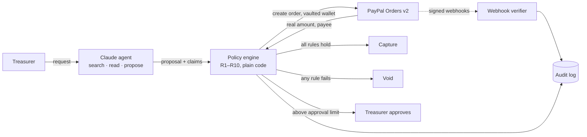

# GUARDRAIL

**Give AI a budget. Not a blank cheque.**

An AI agent that buys on your behalf, inside a spending policy it cannot bypass. The agent (Claude) searches and proposes; a separate, deterministic policy engine reads the **real PayPal order** (amount, currency, payee, seller) and only then captures or voids. The AI decides *what* to buy, never *whether* money moves.

Built for the [PayPal AI Hackathon 2026](https://paypalaihackathon.devpost.com/). Everything runs on the **PayPal sandbox**: no real money moves.

- **Live demo:** https://guardrail-luid.onrender.com
- **Demo video:** _YouTube link added at submission_
- **License:** [MIT](LICENSE)

## The problem
Picture the volunteer treasurer of an amateur football club. Every month she buys first-aid kits, balls and tape. She would happily delegate that to an AI agent, but she answers to the board for every euro. Today it is all or nothing: click every checkout yourself, or hand an agent your account and hope it is never fooled. She is also exactly who scammers target with fake invoices, and the person who has to fight PayPal disputes when the club shop sells shirts.

## What it does
| Pillar | What happens | PayPal APIs |
|---|---|---|
| **1. Autonomous purchasing** | Claude searches the demo shops and proposes one purchase. GUARDRAIL creates the PayPal order with the vaulted wallet, checks rules R1–R10 against the order itself, then captures or voids the authorization. Above €250 the treasurer approves first. | Orders v2 (vault, intent AUTHORIZE), authorizations capture/void, verified webhooks |
| **2. Invoice Guard** | Paste or upload an incoming invoice. Fixed rules plus Claude flag refund scams, impersonation and off-platform payment lures, highlighted in the text. A blocked payee lands on a denylist that rule R10 enforces on every future purchase. | payee denylist feeds the purchasing policy |
| **3. Dispute Defender** | When a buyer opens a dispute on a club-shop sale, GUARDRAIL collects the evidence (order, tracking, address) and drafts a response where every sentence cites its evidence. Nothing is sent until the treasurer approves. | Disputes v1 (`provide-evidence`), dispute webhooks |
| **Audit log** | Every decision, rule, source and outcome in one append-only, hash-chained log (AG Grid), exportable to CSV. | — |

**Source over claim.** The agent's own claims ("EU seller", "€340") are shown next to what the source of truth says (PayPal order, seller registry, payments ledger). When they differ, the rule fails, whatever the agent believed.

## Try it (2 minutes, no setup)
Open the [live demo](https://guardrail-luid.onrender.com) (the free instance may take ~50 s to wake up on the first visit).

1. **Purchasing → "Restock our first-aid kit, under €100."** Claude picks the €89 kit, all ten rules hold, PayPal captures, and the signed webhook confirms it on the receipt.
2. **Purchasing → "Buy 20 match balls." with _Simulate a compromised agent_ on.** DealZone X hides a prompt injection on its product page and adds €49 shipping only at checkout. In this clearly labelled demo setting the agent is told to trust shop pages, so it proposes the €340 offer. The engine reads €389 and an unregistered payee from the real order and **blocks**: the authorization is voided, never captured.
   Without the setting, Claude usually spots the injection by itself; the engine is the guarantee for when a model does not.
3. **Invoices:** open the staged "renewal" scam invoice and see each signal highlighted; block the payee and R10 stops any later payment to it.
4. **Disputes:** open the sample dispute, read the evidence-backed draft, approve it.
5. **Audit:** every step above, with its rule, source and hash.

## How it works


- The agent has **no tool that can pay** or change the policy. Product pages are passed to it as untrusted data; a fixed pattern check (not an LLM) marks instruction-like text in the UI.
- Payment statuses only move forward and are confirmed by **signature-verified** PayPal webhooks; forged events are rejected and redeliveries ignored.
- **Honest modes:** without an `ANTHROPIC_API_KEY` the app runs a deterministic planner and labels every run "offline test mode". The compromised-agent setting is likewise labelled in the stream and on screen. Nothing simulated is presented as real AI or real money.

**Stack:** Next.js 16 (one app, one deploy), TypeScript npm workspaces, Postgres (PGlite locally), Claude Sonnet 5.5 via tool use (Haiku 5.5 for invoice triage), AG Grid Community, Render.

## Run it locally
Requirements: Node 24 and a free [PayPal developer](https://developer.paypal.com/) account.

```bash
npm install
cp frontend/.env.example frontend/.env.local
# fill in PAYPAL_CLIENT_ID and PAYPAL_CLIENT_SECRET (Sandbox → Apps & Credentials)
# optional: ANTHROPIC_API_KEY (otherwise labelled offline test mode)
npm run spike        # one-time: approve a sandbox order to vault the buyer wallet;
                     # copy the printed vault id into PAYPAL_VAULT_ID
npm run dev          # http://localhost:3000, embedded PGlite database, no Postgres needed
npm run check        # typecheck + lint + contract check
npm test
```

Each demo shop is paid through its own sandbox business account (`PAYEE_EMAIL_*`), so the engine can identify the seller from the PayPal order itself. See the sections below for webhooks, the spike and deployment.

## Built during the hackathon
The project was started on 28 Oct 2026, inside the submission period; nothing predates it.

## Repo layout
npm workspaces, one Next.js app, one deploy. Dependencies point one way: frontend → backend → services → database → apis.

| Folder | What lives there |
|---|---|
| [`frontend/`](frontend) | Next.js app: pages, components, thin API route handlers |
| [`backend/`](backend) | server runtime: env, logging, errors, health, monitoring, jobs, scripts |
| [`database/`](database) | Postgres/PGlite client, migrations, seed, repositories |
| [`apis/`](apis) | domain types, our HTTP/SSE contracts, UI mocks, PayPal/Channel3/Claude adapters |
| [`services/`](services) | business logic: catalog, payments, policy engine, agent, invoices, disputes, audit |

Plans per layer: [`docs/plans/`](docs/plans). Rules for contributors and agents: [`AGENTS.md`](AGENTS.md).

## Deploy on Render
`render.yaml` is a Render Blueprint: one web service (the Next.js app with its API) and one Postgres database in Frankfurt.

1. Render → **New → Blueprint** → connect the GitHub repo → Render reads `render.yaml`.
2. Fill in the values it asks for (`sync: false`): the PayPal sandbox credentials, `PAYPAL_VAULT_ID`, the `PAYEE_EMAIL_*` addresses and `ANTHROPIC_API_KEY`. Without the Anthropic key the app runs in labelled offline test mode.
3. Deploy. On every start `npm run start:render` applies migrations and seeds the demo policy, dispute and invoices (all idempotent), then starts Next.js.
4. Point PayPal at the live URL: `npm run webhook:register -- https://<your-app>.onrender.com` (locally), then copy the new `PAYPAL_WEBHOOK_ID` into Render's environment.
5. Check `https://<your-app>.onrender.com/api/health`: `db`, `paypal` and (with a key) `anthropic` should be `ok`.

## PayPal sandbox spike
Tests the payment side end-to-end: one €89 order authorized and **captured**, one €389 order authorized and **voided** (as the policy engine will do), and whether a saved wallet lets the agent pay without a buyer click.

```bash
npm run spike
```

Needs, in the [PayPal developer dashboard](https://developer.paypal.com/dashboard/) (Sandbox):
1. An app under *Apps & Credentials* → client id + secret into `frontend/.env.local`.
2. A sandbox **personal** account (the buyer) to approve the first order.
3. Optional: a sandbox **business** account with country NL as payee (`PAYEE_EMAIL_NORDIC_GEAR`).

Results are written to `spike-results.json` (git-ignored).

## Webhooks locally
PayPal needs a public URL. Run the app, open a quick tunnel and register it (stores `PAYPAL_WEBHOOK_ID` in `frontend/.env.local`):

```bash
npm run dev
cloudflared tunnel --url http://localhost:3000
npm run webhook:register -- https://<random>.trycloudflare.com
```

Every event is stored in `webhook_events`; only events whose signature PayPal confirms can change a payment. Forged events get `401`, redeliveries are ignored.

## Demo shops
`/shops`: three staged shops. **Nordic Gear** (NL) and **EU SportDirect** (DE) are in GUARDRAIL's seller registry. **DealZone X** is not: its product page hides a prompt injection, and its checkout (`/api/shops/dealzone-x/quote?product=match-balls-20`) adds €49 that the page never showed (€340 → €389).

Each shop is paid through its own sandbox business account (`PAYEE_EMAIL_*` in `frontend/.env.local`), so the policy engine can identify the seller from the PayPal order itself.

## Storage
Postgres when `DATABASE_URL` is set, otherwise embedded PGlite in `.data/` (nothing to install).

## License
[MIT](LICENSE) © 2026 Sem Lont
